# SWS405 Digital Forensics – Assignment 2
## MemLabs Memory Forensics Challenge – Labs 1 to 5

**Royal University of Bhutan · College of Science and Technology · Software Engineering Programme**

|  |  |
|---|---|
| **Student Name** | [Kinley Palden] |
| **Student Number** | [02230287] |
| **Module Tutor** | Pema Thinley |
| **Semester** | Autumn Semester 2026 |
| **Submission Date** | 12 October 2026 |
| **Submission Type** | Individual Assignment |

## Contents

- [1. Environment and Setup](#1-environment-and-setup)
- [2. Summary of Flags](#2-summary-of-flags)
- [3. Lab 1 – Beginner's Luck](#3-lab-1--beginners-luck)
- [4. Lab 2 – A New World](#4-lab-2--a-new-world)
- [5. Lab 3 – The Evil's Den](#5-lab-3--the-evils-den)
- [6. Lab 4 – Obsession](#6-lab-4--obsession)
- [7. Lab 5 – Black Tuesday](#7-lab-5--black-tuesday)
- [8. Conclusion](#8-conclusion)

*Note on screenshots: every figure is labelled "Figure L.N", where L is the lab number and N the step in that lab's investigation log. Commands in the logs are shown exactly as typed; long outputs were filtered with grep so the relevant lines are readable, and the unfiltered outputs are kept in the memlabs/out/ folder.*

---

## 1. Environment and Setup

All analysis was carried out on Kali Linux (kernel 7.1.5, zsh shell). The MemLabs challenge images were downloaded from the Mega links in each lab folder of github.com/stuxnet999/MemLabs and extracted with 7-Zip into one folder per lab.

### 1.1 Installing Volatility 2

Part A, Option A of the assignment (sudo apt install volatility) did not work: current Kali releases have removed both the volatility package and Python 2. My first attempt to build a Debian bullseye container also failed because the bullseye security repository now returns 404 (the release is end-of-life). The working setup was:

- Volatility 2.6.1 (cloned from github.com/volatilityfoundation/volatility) running on Python 2.7 inside a Docker container (image python:2.7), with distorm3 and pycryptodome installed. A small wrapper script makes the command available as `volatility`
- Community plugin pack cloned from github.com/superponible/volatility-plugins and passed with `--plugins=$HOME/volatility-plugins`
- steghide, unrar, sqlite3, exiftool and megatools from a Debian bookworm container (same wrapper approach).
- KeePassXC for opening the Lab 2 password database; 7-Zip for the AES-encrypted ZIP in Lab 2.

Other practical issues hit during setup (recorded because they are part of the real investigation):

- A very slow network (~53 KB/s) made the downloads impractical; I changed network (~4.8 MB/s) and restarted them.
- Mega's old folder URL format (#F!id!key) is rejected by megadl; the new format (folder/id#key) worked.
- In zsh, a variable such as P="-f img --profile=X" is NOT word-split, so volatility $P ... silently failed (empty output, "The requested file doesn't exist"). Typing the arguments out explicitly fixed it.
### 1.2 Profiles Identified (imageinfo)

| Lab | Image | Profile used |
|---|---|---|
| 1 | MemoryDump_Lab1.raw | Win7SP1x64 |
| 2 | MemoryDump_Lab2.raw | Win7SP1x64 |
| 3 | MemoryDump_Lab3.raw | Win7SP1x86_23418 (32-bit) |
| 4 | MemoryDump_Lab4.raw | Win7SP1x64 |
| 5 | MemoryDump_Lab5.raw | Win7SP1x64 |

In every case the first profile suggested by imageinfo was used for all later commands, as instructed in Part A, Step 5.

## 2. Summary of Flags

| Lab | Flag | Key plugin / technique |
|---|---|---|
| 1 – Stage 1 | `flag{th1s_1s_th3_1st_st4g3!!}` | consoles → Base64 decode |
| 1 – Stage 2 | `flag{Good_BoY_good_girL}` | memdump of mspaint.exe → raw pixel render |
| 1 – Stage 3 | `flag{w3ll_3rd_stage_was_easy}` | filescan/dumpfiles + hashdump (NTLM) |
| 2 – Stage 1 | `flag{w3lc0m3_T0_$T4g3_!_Of_L4B_2}` | envars → Base64 decode |
| 2 – Stage 2 | `flag{w0w_th1s_1s_Th3_SeC0nD_ST4g3_!!}` | dumpfiles of .kdbx + Password.png |
| 2 – Stage 3 | `flag{oK_So_Now_St4g3_3_is_DoNE!!}` | chromehistory → Mega → SHA1(Lab1 flag 3) |
| 3 | `inctf{0n3_h4lf_1s_n0t_3n0ugh}` | cmdline/dumpfiles, XOR reversal, steghide |
| 4 | `inctf{1_is_n0t_EQu4l_7o_2_bUt_th1s_d0s3nt_m4ke_s3ns3}` | mftparser (resident $DATA) |
| 5 – Stage 1 | `flag{!!_w3LL_d0n3_St4g3-1_0f_L4B_5_D0n3_!!}` | iehistory → Base64 filename |
| 5 – Stage 2 | `flag{W1th_th1s_$taGe_2_1s_c0mPL3T3_!!}` | dumpfiles of .rar + Stage 1 flag as password |

*Lab 6 (optional bonus) was not attempted.*

---

## 3. Lab 1 – Beginner's Luck

*Scenario: a relative's computer crashed while she was doing several things at once – something in a terminal, trying to draw something, and working with an important archive. Three flags.*

### 3.1 Investigation Log

```text
$ cd ~/Desktop/SWS405/SWS405_a2/memlabs/Lab1
1.1  $ volatility -f MemoryDump_Lab1.raw imageinfo
        → Win7SP1x64
1.2  $ volatility -f MemoryDump_Lab1.raw --profile=Win7SP1x64 pslist
        → cmd.exe(1984) mspaint.exe(2424) WinRAR.exe(1512) DumpIt.exe(796)
     $ ... pstree / envars
        → nothing unusual (dead end)
1.3  $ ... cmdscan
        → cmd.exe ran "St4G3$1"
1.4  $ ... consoles
        → screen buffer shows Base64 output
1.5  $ echo ZmxhZ3t0aDFzXzFzX3RoM18xc3Rfc3Q0ZzMhIX0= | base64 -d
        → FLAG 1
1.6  $ ... cmdline -p 1512
        → WinRAR opened ...\Documents\Important.rar
1.7  $ ... filescan | grep -i important.rar
        → offset 0x3fa3ebc0
     $ ... dumpfiles -Q 0x000000003fa3ebc0 -D dump/ ; cp file.None.*.dat Important.rar
1.8  $ unrar l Important.rar
        → "Password is NTLM hash (in uppercase) of Alissa's passwd"
1.9  $ ... hashdump
        → Alissa Simpson NT hash f4ff64c8baac57d22f22edc681055ba6
1.10 $ unrar x -pF4FF64C8BAAC57D22F22EDC681055BA6 Important.rar
        → All OK, flag3.png
1.11 $ xdg-open flag3.png
        → FLAG 3
1.12 $ ... memdump -p 2424 -D dump/
        → 2424.dmp (266 MB)
     dead end: rendered the largest all-white regions (0x1b80000, 0x9550000,
               0x3170000) at width 1280 - only blank canvas and icon bitmaps
     dead end: searched for black-on-white 'stroke' blocks - only found fonts
     working:  searched for 64 KB blocks that were ~100% grey and 85-97% white
               = 0xac40000; autocorrelation gave a row stride of 819 pixels
1.13 $ python3 scripts/raw2png.py dump/2424.dmp 0xac20000 819 450 dump/paint.png
        → FLAG 2
```

### 3.2 Evidence

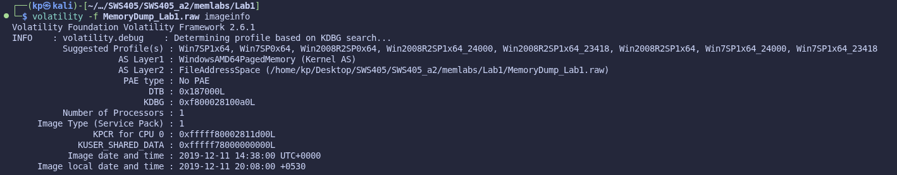

*Figure 1.1 – imageinfo identifies the profile as Win7SP1x64.*

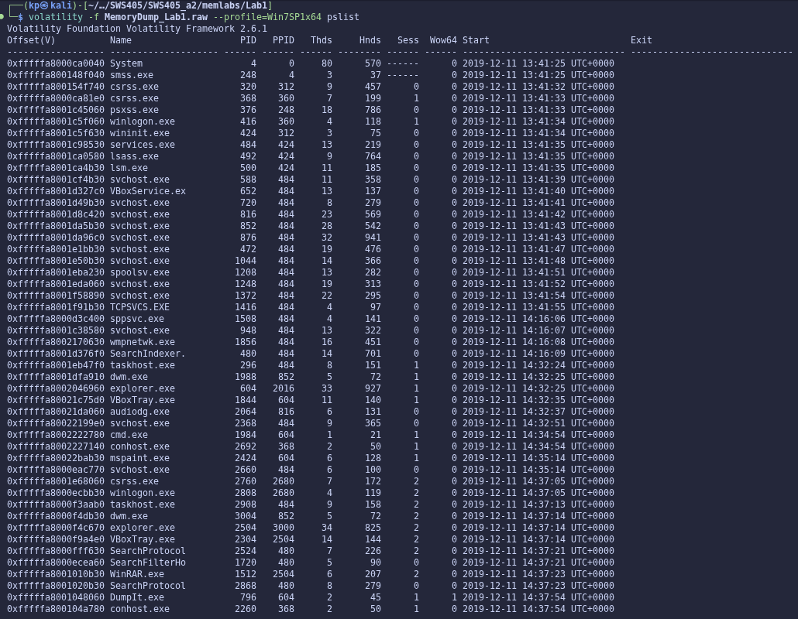

*Figure 1.2 – pslist – user processes cmd.exe, mspaint.exe and WinRAR.exe, and the acquisition tool DumpIt.exe.*

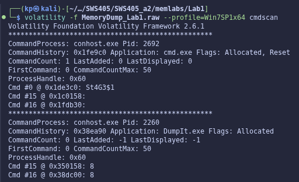

*Figure 1.3 – cmdscan – the command history of cmd.exe contains the command St4G3$1.*

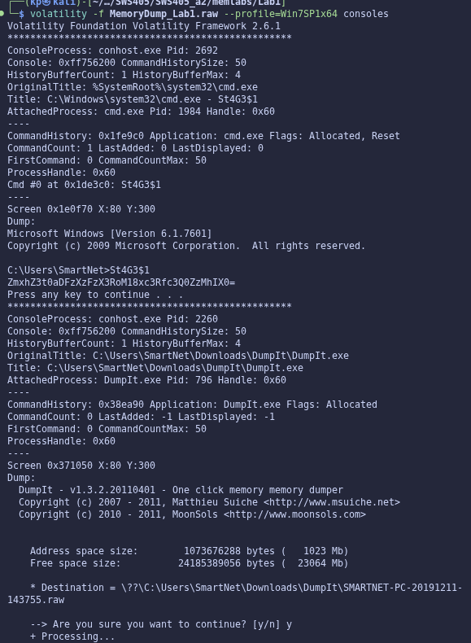

*Figure 1.4 – consoles – the console screen buffer shows the Base64 string printed by St4G3$1.*

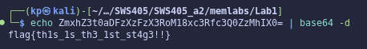

*Figure 1.5 – Decoding the Base64 string reveals Flag 1.*

> **Lab 1 – Flag 1:** `flag{th1s_1s_th3_1st_st4g3!!}`

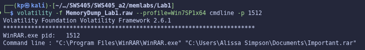

*Figure 1.6 – cmdline of WinRAR.exe (PID 1512) shows the archive that was open: Important.rar.*

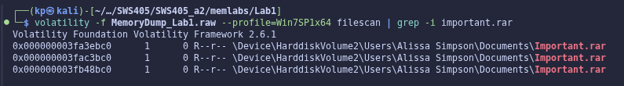

*Figure 1.7 – filescan locates Important.rar in memory and gives its physical offset.*

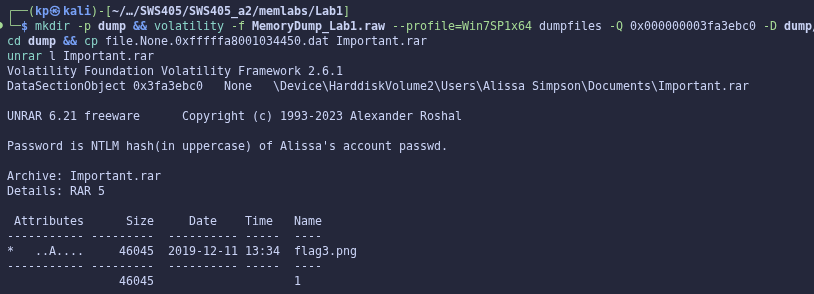

*Figure 1.8 – The extracted archive's comment says the password is Alissa's NTLM hash in uppercase.*

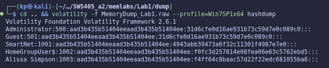

*Figure 1.9 – hashdump recovers the NT hash for the account "Alissa Simpson".*

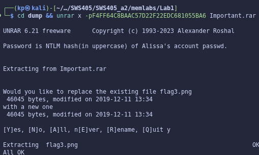

*Figure 1.10 – unrar extracts flag3.png using the uppercase NTLM hash as the password.*

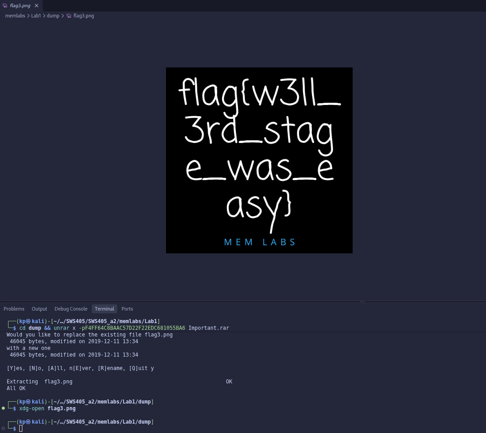

*Figure 1.11 – flag3.png – Flag 3.*

> **Lab 1 – Flag 3:** `flag{w3ll_3rd_stage_was_easy}`

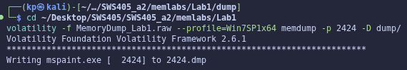

*Figure 1.12 – memdump writes the full address space of mspaint.exe (PID 2424) to 2424.dmp.*

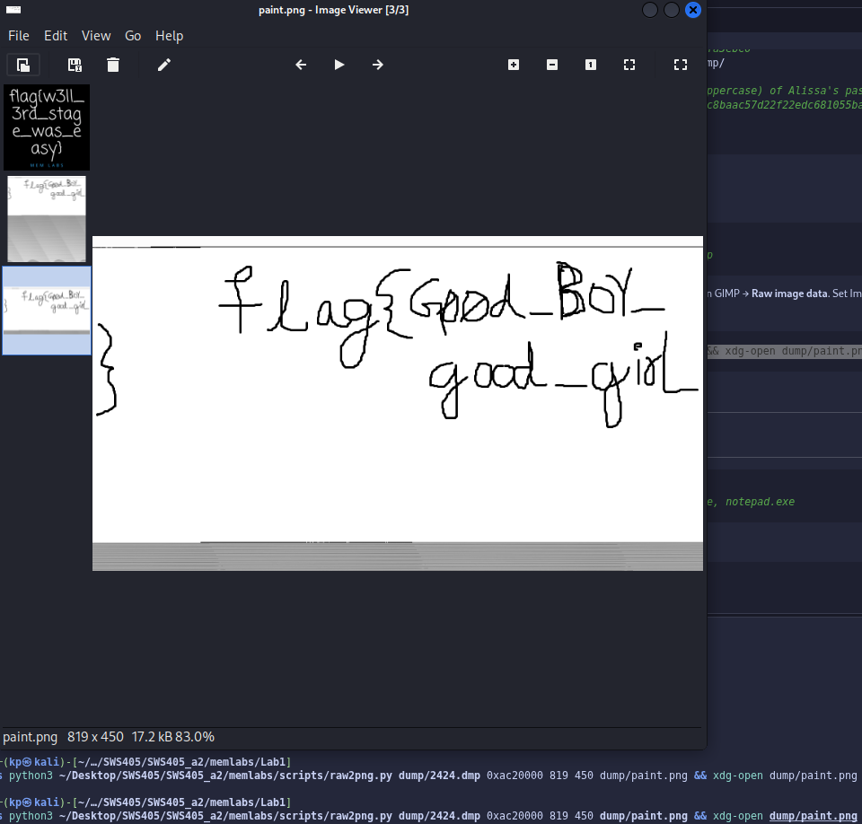

*Figure 1.13 – Raw pixels from 2424.dmp (offset 0xac20000, width 819) rendered as an image – Flag 2.*

> **Lab 1 – Flag 2:** `flag{Good_BoY_good_girL}`

### 3.3 Forensic Reasoning

cmdscan and consoles were the right tools for the first flag because cmd.exe does not keep its own history – the conhost.exe process holds both the command history buffer and the screen buffer in memory. cmdscan only shows what was typed (St4G3$1), while consoles also shows what the program printed back, which is where the encoded flag was. For the third flag, hashdump was the right choice because the SAM and SYSTEM registry hives are loaded in RAM, so the NT hashes can be decrypted straight from memory without the hard disk; the archive comment asked for the hash itself, so no password cracking was needed. For the second flag, the drawing had never been saved as a file, so filescan and dumpfiles had nothing to find – the only copy of the picture was the bitmap held inside mspaint's own process memory, which is why memdump of the process (and interpreting the bytes as pixels) was required.

---

## 4. Lab 2 – A New World

*Scenario: an "environmental" activist lost access to his system; his main applications are browsers and password managers. Three flags, one of which depends on a Lab 1 flag.*

### 4.1 Investigation Log

```text
$ cd ~/Desktop/SWS405/SWS405_a2/memlabs/Lab2
     $ volatility -f MemoryDump_Lab2.raw imageinfo
        → Win7SP1x64
2.1  $ ... --profile=Win7SP1x64 pslist
        → chrome.exe (several), KeePass.exe(3008), notepad.exe
     $ ... cmdscan
        → cmd.exe history: "Nothing here kids :)" (dead end)
2.2  $ ... envars | grep NEW_TMP
        → C:\Windows\ZmxhZ3t3M2xjMG0zX1QwXyRUNGczXyFfT2ZfTDRCXzJ9
2.3  $ echo ZmxhZ3t3M2xj...TDRCXzJ9 | base64 -d
        → FLAG 1
2.4  $ ... filescan | grep -iE 'kdbx|password'
        → \Users\SmartNet\Secrets\Hidden.kdbx (0x3fb112a0)
                                                   \Users\Alissa Simpson\Pictures\Password.png (0x3fce1c70)
     $ ... dumpfiles -Q 0x000000003fb112a0 -D dump/ ; dumpfiles -Q 0x000000003fce1c70 -D dump/
2.5  $ xdg-open dump/Password.png
        → small text bottom-right: "password is P4SSw0rd_123"
     dead end: the dumped .kdbx would not open at first ("Data must be padded
               to 16 byte boundary") because dumpfiles pads to a 4096-byte page;
               trimming to the real size (3422 bytes) fixed it
2.6  KeePassXC
        → Hidden.kdbx, master password P4SSw0rd_123 -> Recycle Bin -> 'Sabka Baap'  -> FLAG 2
     (General group entries 'fake', 'fake again', 'oh not again!', 'why God!!' were decoys)
2.7  $ volatility --plugins=$HOME/volatility-plugins ... chromehistory | grep -i mega
        → https://mega.nz/#F!TrgSQQTS!H0ZrUzF0B-ZKNM3y9E76lg
2.8  downloaded Important.zip from the Mega folder
2.9  $ unzip -z Important.zip
        → "Password is SHA1(stage-3-FLAG) from Lab-1. lowercase"
2.10 $ echo -n 'flag{w3ll_3rd_stage_was_easy}' | sha1sum
        → 6045dd90029719a039fd2d2ebcca718439dd100a
     $ 7z x -p6045dd90029719a039fd2d2ebcca718439dd100a Important.zip  (unzip cannot do AES)
2.11 $ xdg-open Important.png
        → FLAG 3
```

### 4.2 Evidence

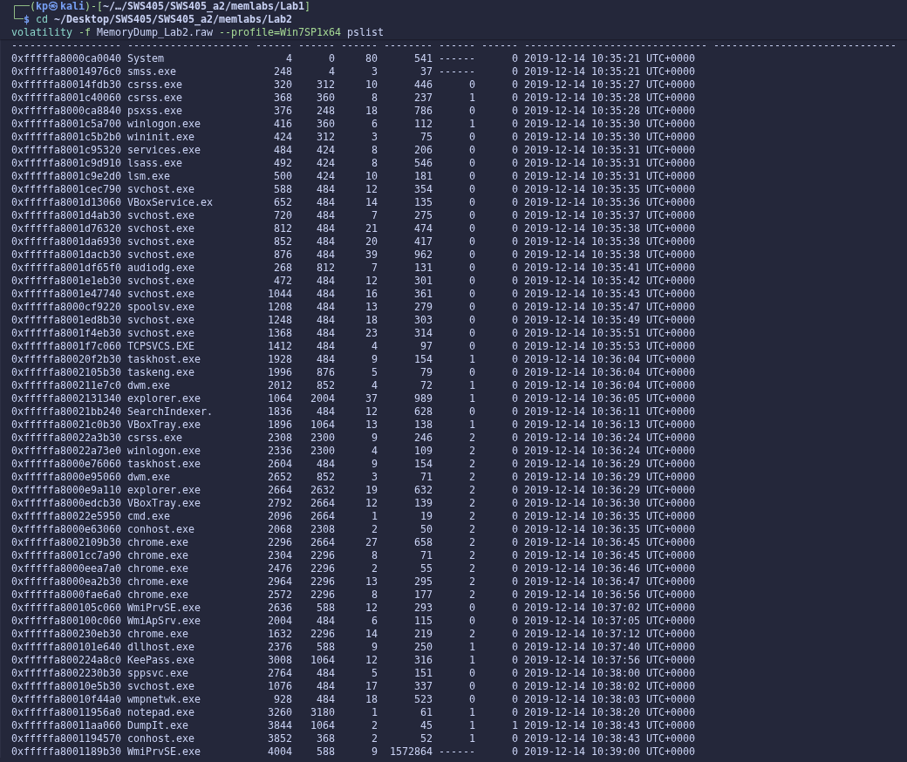

*Figure 2.1 – pslist – Chrome (browser session) and KeePass (password manager) are both running.*

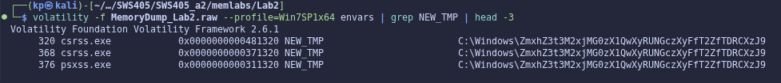

*Figure 2.2 – envars – the custom NEW_TMP variable contains a Base64-looking path in every process.*

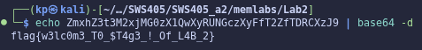

*Figure 2.3 – Decoding the NEW_TMP value gives Flag 1.*

> **Lab 2 – Flag 1:** `flag{w3lc0m3_T0_$T4g3_!_Of_L4B_2}`

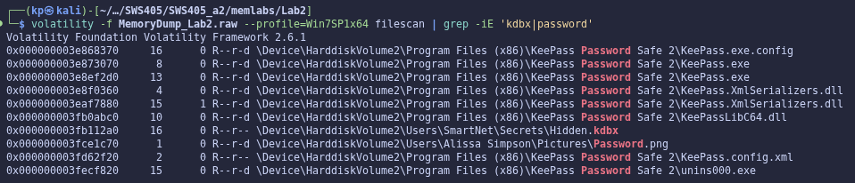

*Figure 2.4 – filescan shows the KeePass database Hidden.kdbx and an image named Password.png.*

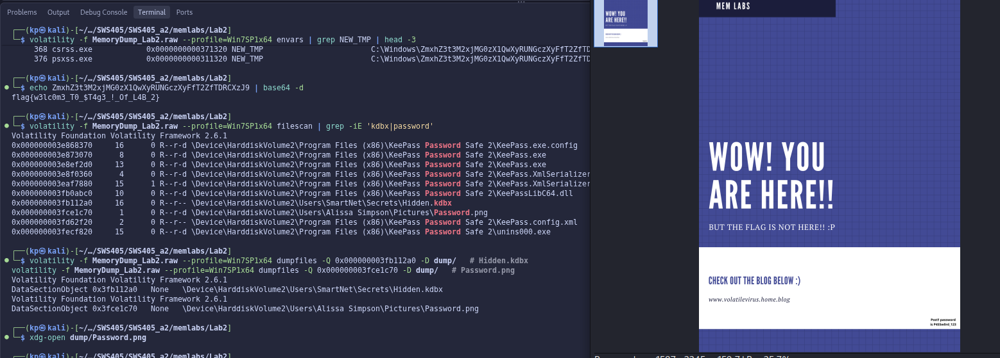

*Figure 2.5 – Password.png extracted from memory – the KeePass master password is hidden in the bottom-right corner.*

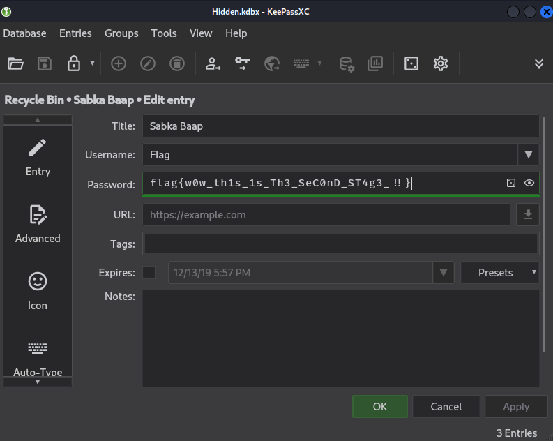

*Figure 2.6 – Hidden.kdbx opened in KeePassXC; the deleted entry "Sabka Baap" in the Recycle Bin holds Flag 2.*

> **Lab 2 – Flag 2:** `flag{w0w_th1s_1s_Th3_SeC0nD_ST4g3_!!}`

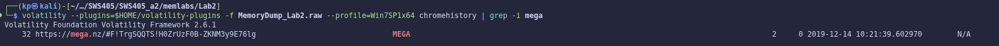

*Figure 2.7 – chromehistory (community plugin) – a visited Mega folder link.*

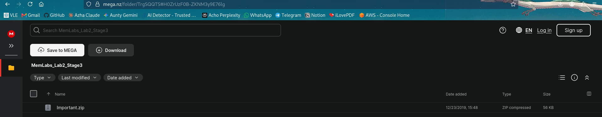

*Figure 2.8 – The Mega folder contains Important.zip.*

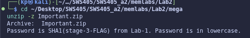

*Figure 2.9 – The ZIP comment explains how to derive the password from the Lab 1 stage-3 flag.*

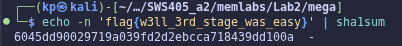

*Figure 2.10 – SHA1 of the Lab 1 stage-3 flag (lowercase hex) is used to open the AES-encrypted ZIP.*

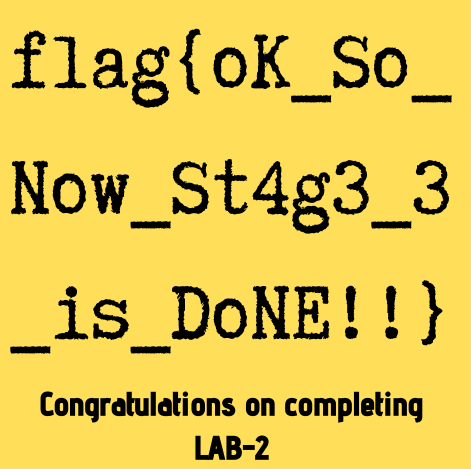

*Figure 2.11 – Important.png – Flag 3.*

> **Lab 2 – Flag 3:** `flag{oK_So_Now_St4g3_3_is_DoNE!!}`

### 4.3 Forensic Reasoning

envars worked for Flag 1 because every process keeps a copy of its environment block in its Process Environment Block (PEB) in memory; a variable set system-wide therefore appears in every process listing, which made the unusual NEW_TMP value easy to spot. For Flag 2, filescan finds file objects that the system has open or cached, and dumpfiles rebuilds them from cached pages – this gave both the password database and the image containing its master password. The flag was in the KeePass Recycle Bin, which shows that "deleting" an entry in an application only moves it until the bin is emptied – the data is still present. For Flag 3, the community chromehistory plugin parses Chrome's SQLite History database from memory, which revealed the external Mega link.

Password derivation for the final archive: the ZIP comment said "Password is SHA1(stage-3-FLAG) from Lab-1. Password is in lowercase." I took the full Lab 1 stage-3 flag string, flag{w3ll_3rd_stage_was_easy}, including "flag{" and "}", and computed its SHA-1 hash with echo -n (so no trailing newline is hashed) piped into sha1sum. sha1sum already prints lowercase hexadecimal, giving 6045dd90029719a039fd2d2ebcca718439dd100a, which opened the AES-encrypted ZIP with 7-Zip.

---

## 5. Lab 3 – The Evil's Den

*Scenario: a malicious script encrypted a secret on the system. One flag split into two halves; the first half is needed to obtain the second (Note-2).*

### 5.1 Investigation Log

```text
$ cd ~/Desktop/SWS405/SWS405_a2/memlabs/Lab3
3.1  $ volatility -f MemoryDump_Lab3.raw imageinfo
        → Win7SP1x86_23418 (32-bit image, different from other labs)
     $ ... --profile=Win7SP1x86_23418 pslist
        → two notepad.exe processes (3736, 3432)
3.2  $ ... cmdline | grep -i -A1 notepad
        → notepad opened Desktop\evilscript.py and Desktop\vip.txt
3.3  $ ... filescan | grep -iE 'evilscript|vip.txt|\.jpe?g' | grep -vE 'Windows|Python27'
        → evilscript.py.py (0x3de1b5f0), vip.txt (0x3e727e50), suspision1.jpeg (0x04f34148)
     dead end: first dumpfiles attempts printed "The requested file doesn't
               exist" - my zsh $P variable was not word-split; typing the
               arguments out in full fixed it
     $ ... dumpfiles -Q 0x000000003de1b5f0 / 0x000000003e727e50 / 0x0000000004f34148 -D dump/
     $ cp the file.None.*.dat outputs to evilscript.py, vip.txt and suspision1.jpeg
3.4  $ cat evilscript.py
        → XOR every char with 3, then base64, write to vip.txt
3.5  $ cat vip.txt
        → am1gd2V4M20wXGs3b2U=
3.6  $ python3 reverse_evilscript.py vip.txt
        → inctf{0n3_h4lf        (first half)
3.7  $ steghide extract -sf suspision1.jpeg -p 'inctf{0n3_h4lf'
        → wrote "secret text"
3.8  $ cat "secret text"
        → _1s_n0t_3n0ugh}                         (second half)
```

### 5.2 Evidence

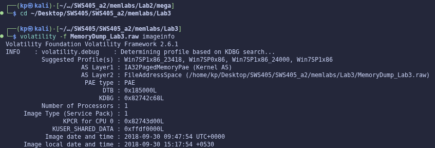

*Figure 3.1 – imageinfo – this image is 32-bit (Win7SP1x86_23418).*

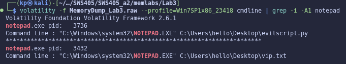

*Figure 3.2 – cmdline – notepad.exe had evilscript.py and vip.txt open.*

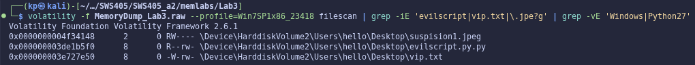

*Figure 3.3 – filescan – the script, its output file and the out-of-place image suspision1.jpeg.*

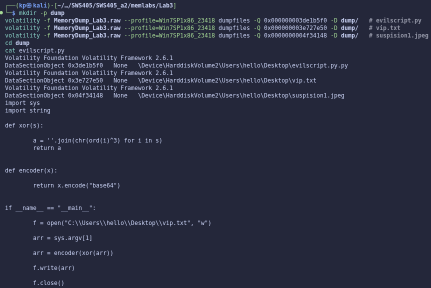

*Figure 3.4 – The recovered evilscript.py.*

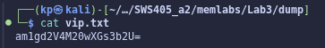

*Figure 3.5 – The script's output, vip.txt.*

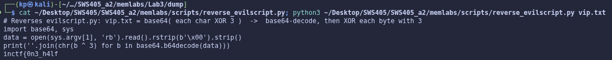

*Figure 3.6 – My reversing script and its output – the first half of the flag.*

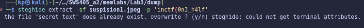

*Figure 3.7 – steghide extracts hidden data from suspision1.jpeg using the first half as the passphrase.*

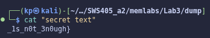

*Figure 3.8 – The extracted "secret text" – the second half of the flag.*

> **Lab 3 – Flag:** `inctf{0n3_h4lf_1s_n0t_3n0ugh}`

### 5.3 What the Malicious Script Did and How I Reversed It

evilscript.py takes the secret from its first command-line argument (sys.argv[1]). The xor() function replaces every character with chr(ord(c) ^ 3), i.e. it XORs each byte with the key 3. The result is then Base64-encoded with x.encode("base64") and written to C:\Users\hello\Desktop\vip.txt. So: vip.txt = Base64( XOR3(secret) ).

To reverse it the steps are undone in the opposite order: first Base64-decode the contents of vip.txt, then XOR every byte with 3 again. XOR is its own inverse ((x ^ 3) ^ 3 = x), so the same key restores the original text. My script:

```text
import base64, sys
data = open(sys.argv[1], 'rb').read().rstrip(b'\x00').strip()     # dumpfiles pads with NUL bytes
print(''.join(chr(b ^ 3) for b in base64.b64decode(data)))
```

For the second half, filescan listed several images but only suspision1.jpeg had an unusual name on the user's Desktop. steghide needs a passphrase, and Note-2 says the first half is needed to get the second, so the natural passphrase was the first half itself, inctf{0n3_h4lf}, which worked first time.

### 5.4 Forensic Reasoning

cmdline was the key starting point because a process's full command line is stored in its PEB, so even after the files were closed in the editor the paths they were opened with were still recorded in memory. filescan and dumpfiles then let me recover the actual file contents from the Windows file cache, which is evidence that never had to be taken from the disk. Reading the script rather than just running it allowed me to explain the exact transformation and reverse it reliably.

---

## 6. Lab 4 – Obsession

*Scenario: the user was obsessed with an important file and the system crashed; at least one Desktop file was deleted. One flag.*

### 6.1 Investigation Log

```text
$ cd ~/Desktop/SWS405/SWS405_a2/memlabs/Lab4
     $ volatility -f MemoryDump_Lab4.raw imageinfo
        → Win7SP1x64
     $ ... pslist / cmdline
        → nothing suspicious, DumpIt only
4.1  $ ... filescan | grep -iE 'Desktop\\[^\\]+\.(txt|jpe?g|png)$'
        → eminem\Desktop\galf.jpeg, eminem\Desktop\Screenshot1.png,
          SlimShady\Desktop\Important.txt
     DEAD END (steganography on the suspicious image 'galf' = 'flag' reversed):
     $ ... dumpfiles -Q 0x000000003e8ad250 -D dump/ ; cp ... galf.jpeg
4.2  $ steghide extract -sf galf.jpeg -p '' && cat LMAO.txt
        → "Move on bro, there is nothing here :)"
     $ exiftool galf.jpeg ; strings galf.jpeg | grep -i inctf
        → nothing
4.3  $ ... dumpfiles -Q 0x000000003fc398d0 -D dump/ ; ls dump
        → no file written for Important.txt
4.4  $ ... mftparser > mft.txt ; grep -n -B22 -A15 'Desktop\\Important.txt' mft.txt
        → MFT record 60583, resident $DATA: i..n..ct..f{1.._is.._n0t.._EQu4l...
4.5  removed the 0d 0a (CR LF) bytes from the $DATA content
        → FLAG
```

### 6.2 Evidence

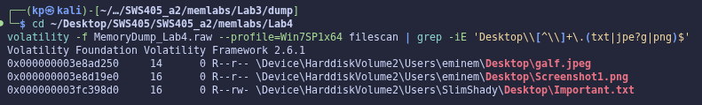

*Figure 4.1 – filescan of the Desktop folders – galf.jpeg, Screenshot1.png and Important.txt.*

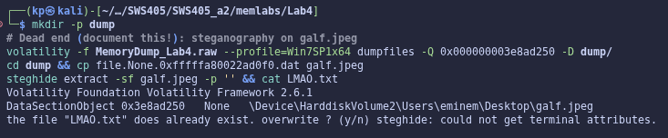

*Figure 4.2 – Dead end: steghide on galf.jpeg (empty passphrase) only gives LMAO.txt – "Move on bro".*

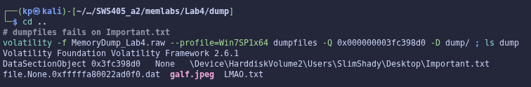

*Figure 4.3 – dumpfiles on Important.txt writes nothing, even though filescan lists the file.*

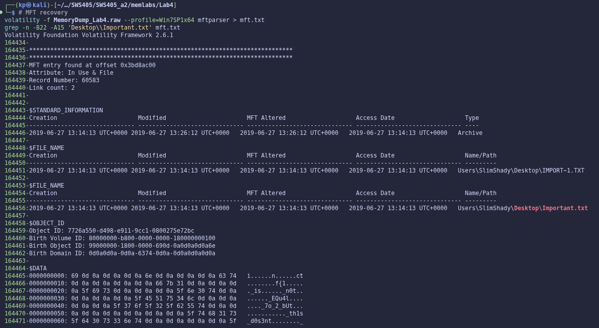

*Figure 4.4 – mftparser – MFT record 60583 for Important.txt with its content stored in the resident $DATA attribute.*

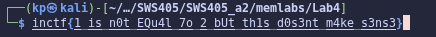

*Figure 4.5 – The flag reconstructed from the $DATA bytes after removing the CR/LF characters.*

> **Lab 4 – Flag:** `inctf{1_is_n0t_EQu4l_7o_2_bUt_th1s_d0s3nt_m4ke_s3ns3}`

### 6.3 Why dumpfiles Failed but mftparser Succeeded

filescan works by finding FILE_OBJECT structures in kernel pool memory, so it can still list a file whose object is left behind after the file has been closed or deleted. dumpfiles, however, does not read the file from disk – it can only rebuild a file from data pages that the Windows cache manager still holds in RAM (the DataSectionObject, ImageSectionObject or SharedCacheMap of that file). For Important.txt those cached pages were no longer in memory, so there was nothing to write out. The NTFS Master File Table is different: each file has a 1 KB MFT record, and when a file is very small (roughly under 700 bytes) NTFS stores its contents directly inside that record as a resident $DATA attribute instead of in separate clusters. Because the MFT record for Important.txt was still sitting in memory, mftparser could parse it and print the file's content even though the file itself could not be dumped. In short, a file being listed is not the same as its data being recoverable – you have to look for another copy of the data, and for small files the MFT is that copy.

### 6.4 Why the Steganography Dead End Still Counts

The image galf.jpeg ("flag" spelled backwards) looked like the obvious target, so I tested it with steghide, exiftool and strings. It only produced a joke message. Documenting this is still good forensic practice: it shows the examiner considered and excluded a likely hiding place, it lets another investigator reproduce the result instead of repeating the work, and it explains why the investigation moved on to the MFT. A report that only shows the successful step would hide how the conclusion was reached.

---

## 7. Lab 5 – Black Tuesday

*Scenario: the user's system crashed after something happened while working; an archive manager was in use. Two flags – the first unlocks the second. README Note-2: change "_L4B_3_D0n3_!!" to "_L4B_5_D0n3_!!".*

### 7.1 Investigation Log

```text
$ cd ~/Desktop/SWS405/SWS405_a2/memlabs/Lab5
     $ volatility -f MemoryDump_Lab5.raw imageinfo
        → Win7SP1x64
5.1  $ ... --profile=Win7SP1x64 pslist
        → WinRAR.exe(2924), several NOTEPAD.EXE + WerFault.exe
5.2  $ ... cmdline -p 2924
        → WinRAR opened ...\Documents\SW1wb3J0YW50.rar
5.3  $ ... filescan | grep -i '\.rar'
        → offset 0x3eed56f0
     $ ... dumpfiles -Q 0x000000003eed56f0 -D dump/ ; cp dump/file.None.*.dat dump/SW1wb3J0YW50.rar
5.4  $ unrar l dump/SW1wb3J0YW50.rar
        → Stage2.png, encrypted (*), needs a password
     note: 'SW1wb3J0YW50' is Base64 for 'Important'
     $ volatility --plugins=... chromehistory
        → empty table, no Chrome history (dead end)
5.5  $ ... iehistory | grep -i ZmxhZ3
        → Pictures\ZmxhZ3shIV93M0xMX2Qwbj...EhfQ.bmp
5.6  $ echo ZmxhZ3shIV93M0xMX2QwbjNfU3Q0ZzMtMV8wZl9MNEJfM19EMG4zXyEhfQ== | base64 -d
        → flag{!!_w3LL_d0n3_St4g3-1_0f_L4B_3_D0n3_!!}  -> corrected to L4B_5 per Note-2  -> FLAG 1
5.7  $ unrar x -p'flag{!!_w3LL_d0n3_St4g3-1_0f_L4B_5_D0n3_!!}' dump/SW1wb3J0YW50.rar dump/
        → All OK
5.8  $ xdg-open dump/Stage2.png
        → FLAG 2
```

### 7.2 Evidence

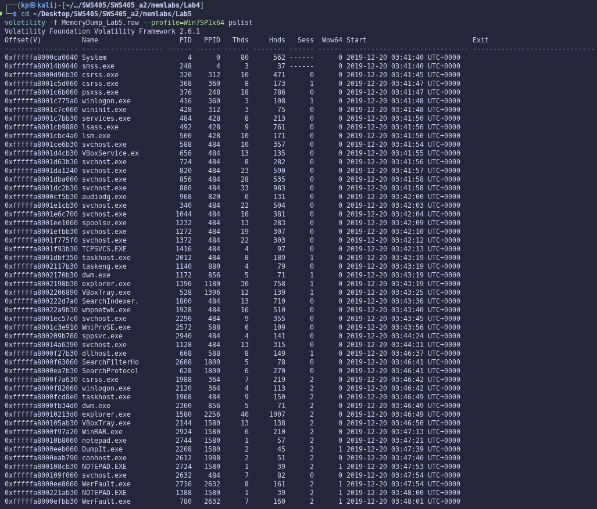

*Figure 5.1 – pslist – WinRAR.exe is running; notepad crashes (WerFault.exe) but nothing obviously malicious.*

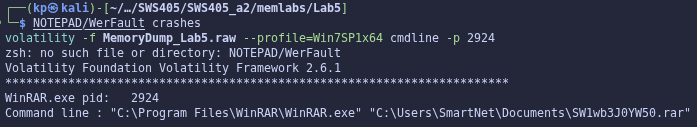

*Figure 5.2 – cmdline of WinRAR.exe – the archive SW1wb3J0YW50.rar was open.*

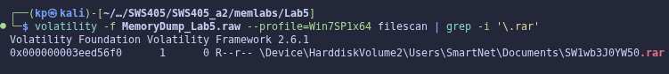

*Figure 5.3 – filescan locates SW1wb3J0YW50.rar and its offset.*

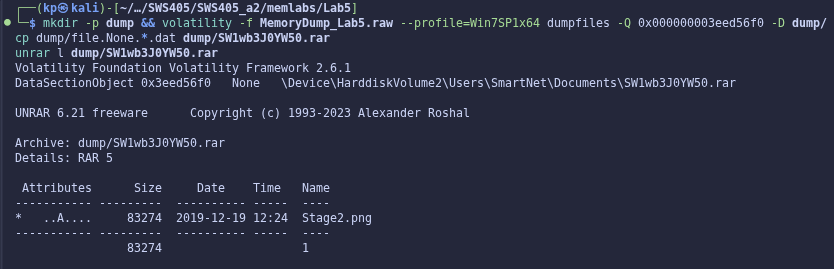

*Figure 5.4 – The dumped archive contains an encrypted Stage2.png.*

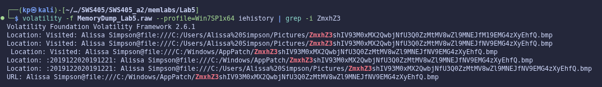

*Figure 5.5 – iehistory – a visited file with a long, Base64-encoded .bmp filename.*

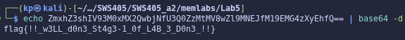

*Figure 5.6 – Decoding the filename gives the stage-1 flag (corrected from L4B_3 to L4B_5 as per the README).*

> **Lab 5 – Flag 1:** `flag{!!_w3LL_d0n3_St4g3-1_0f_L4B_5_D0n3_!!}`

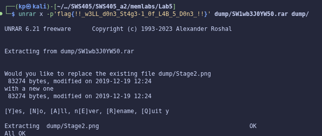

*Figure 5.7 – The stage-1 flag is the password that extracts Stage2.png.*


*Figure 5.8 – Stage2.png – Flag 2.*

> **Lab 5 – Flag 2:** `flag{W1th_th1s_$taGe_2_1s_c0mPL3T3_!!}`

### 7.3 Forensic Reasoning

Browser-history plugin: I used the built-in iehistory plugin, because this system's history is held by Internet Explorer's WinINet index.dat cache files (which also record file:// paths opened through Explorer), whereas the Lab 2 chromehistory plugin only parses Google Chrome's SQLite History database, which does not exist on this machine.

cmdline and filescan located the archive the same way as in Lab 1, but this time the password was not a credential stored by Windows. Because the process list showed nothing malicious, widening the search to browsing history was the logical next step: the long filename that started with "ZmxhZ3" (Base64 for "flag{") stood out immediately among normal URLs, and decoding it gave the first flag, which in turn was the archive password.

---

## 8. Conclusion

All ten flags from Labs 1–5 were recovered using only a memory image. Across the labs the same lesson repeated: RAM holds far more than running processes – console screen buffers, environment variables, cached copies of files, registry hives with password hashes, browser history and even MFT records of files that can no longer be dumped. Following the Part B checklist (scope, commands, environment, files, credentials, deleted data, browser artefacts) rather than jumping straight to the flag meant that dead ends such as the Lab 4 decoy image were recognised quickly and documented, and every flag can be traced back to a specific plugin and artefact shown in the figures above.
